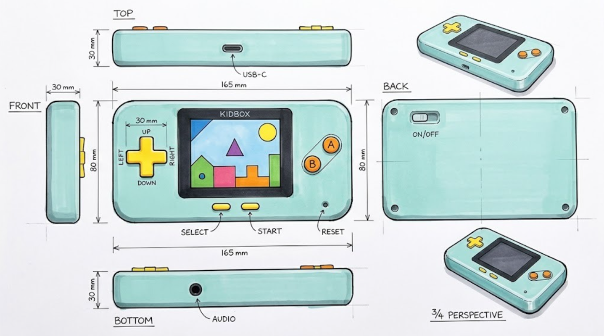

# KIDBOX — Diagramas y Bocetos de Diseño Físico
**Documento de Diseño Mecánico e Industrial · Versión 1.0 (KIDBOX V1)**  
*Proyecto: Consola Portátil Educativa para Niños de 6 a 10 Años*

---

## 1. Concepto General de Distribución

El concepto seleccionado para **KIDBOX V1** adopta una **disposición horizontal (estilo apaisado o landscape)**. Esta configuración ofrece ventajas críticas para el segmento infantil objetivo:

1. **Separación ergonómica:** Permite distanciar la mano izquierda (área de navegación / D-Pad) de la mano derecha (área de botones de acción A/B), adaptándose a la envergadura de agarre de niños entre 6 y 10 años.
2. **Centro de gravedad equilibrado:** Sitúa la pantalla TFT de 2.4" en el centro geométrico del dispositivo, evitando momentos de torsión o fatiga en las muñecas durante sesiones continuas.
3. **Distribución simétrica de masa:** Los componentes de mayor peso (módulo Waveshare RP2350-Plus y batería LiPo) se ubican en la cara posterior, detrás de la pantalla y cerca del centro, otorgando estabilidad al sostener la consola con ambas manos.

---

## 2. Vista Frontal Propuesta

Boceto preliminar de la cara frontal con la distribución espacial de controles e interfaz visual (coincide con el layout de la PCB):

```text
                                [USB-C]  ← borde superior
  ╭─────────────────────────────────────────────────────────────────╮
  │                    ┌───────────────────────┐                    │
  │        ▲           │                       │                    │
  │      ┌─┴─┐         │                       │           ( A )    │
  │   ◄──┤   ├──►      │   TFT 2.4" ILI9341    │                    │
  │      └─┬─┘         │      320 × 240        │      ( B )         │
  │        ▼           │                       │                    │
  │     [D-PAD]        └───────────────────────┘                    │
  │                       [SELECT]   [START]               (RESET)  │
  ╰─────────────────────────────────────────────────────────────────╯
                    [JACK 3,5 mm]  ← borde inferior

  Cara posterior: interruptor ON/OFF en un rebaje de la carcasa
  (arriba a la izquierda vista desde atrás, detrás de los botones A/B).
```



*Boceto conceptual. Dimensiones aproximadas (165 × 80 × 30 mm), sujetas a validación con la PCB final y las piezas medidas. Nota: en la imagen, el rótulo "FRONT" quedó sobre la vista lateral izquierda; la vista frontal es la central.*

La distribución exacta de la PCB (escala 1:1, cara frontal y posterior) está en [hardware/datasheets/layout_propuesto.png](hardware/datasheets/layout_propuesto.png).

> [!TIP]
> **Accesibilidad de Puertos:**
> - El puerto **USB-C** se ubica al centro del canto superior, como en un control de PlayStation: permite jugar mientras carga sin que el cable moleste las manos.
> - El **interruptor ON/OFF** (deslizante recto, conectado a `3V3_EN`) va en la **cara posterior**, dentro de un rebaje de la carcasa, para que no se apague sin querer durante el juego.
> - La salida para **Audífonos (Jack 3,5 mm)** se sitúa en el canto inferior, a un tercio del ancho desde la izquierda, para evitar enredos del cable mientras el niño juega.

---

## 3. Controles Físicos y Cinemática de Pulsadores

La interfaz de usuario mecánica consta de **9 tact switches de 6×6 mm** (8 de juego + RESET) soldados a la placa portadora (Carrier PCB):

| Grupo de Control | Función | Cantidad | Tipo de Componente | Interacción Mecánica |
|:---|:---|:---:|:---|:---|
| **Navegación** | ↑, ↓, ←, → | 4 | Tact switch 6×6 mm THT | Accionamiento indirecto mediante cruceta (D-pad) 3D |
| **Acción** | A, B | 2 | Tact switch 6×6 mm THT | Botones cilíndricos individuales con guía antirotación |
| **Sistema** | Start, Select | 2 | Tact switch 6×6 mm THT | Botones de perfil bajo para prevenir pulsaciones accidentales |
| **Reinicio** | RESET | 1 | Tact switch 6×6 mm THT | Pulsador pequeño en la esquina inferior derecha, alejado de los pulgares (pin RUN del módulo) |
| **TOTAL** | | **9** | | |

### Mecanismo de Cruceta 3D (D-Pad)
- **Accionamiento unificado:** La cruceta exterior es una pieza única impresa en 3D con un pivote semiesférico central que actúa como fulcro.
- **Prevención de conflictos:** El pivote impide la pulsación simultánea de direcciones opuestas (evita presionar izquierda y derecha al mismo tiempo), protegiendo la lógica de navegación.
- **Optimización de costos:** No requiere adquirir módulos de membrana ni pulsadores industriales costosos; se emplean tact switches estándar disponibles en el DEC UAI.

---

## 4. Corte Lateral Conceptual (Estratigrafía de Ensamble)

El orden de apilamiento vertical (*stackup*) interior maximiza la protección del display y optimiza el ruteo interno:

```text
                     FRENTE (lo que ve el niño)
      ═════════════════════════════════════════════════════════════
      ▲   ┌───────────────────────────────────────────────────┐
      │   │        Carcasa Superior (Bezel / Front)   ~2 mm   │
      │   ├───────────────────────────────────────────────────┤
      │   │  Pantalla TFT 2.4" sobre tira hembra  ~12–13 mm   │  (Rebajada)
      │   │  + 9 pulsadores 6×6 con capuchones 3D             │
      │   ├───────────────────────────────────────────────────┤
   Eje Z  │        Carrier PCB KIDBOX (2 capas)       1,6 mm  │
 (Altura) ├────────────────┬───────────────┬──────────────────┤
      │   │ DAC PCM5102A   │ RP2350-Plus   │ Batería LiPo 1S  │  ~12 mm
      │   │ (sobre tira)   │ (sobre tiras) │ (bahía libre,    │  (mismo nivel:
      │   │                │               │  ≤10 mm)         │   no se apilan)
      │   ├────────────────┴───────────────┴──────────────────┤
      ▼   │        Carcasa Inferior (Tapa Trasera)    ~2 mm   │
          └───────────────────────────────────────────────────┘
                     ATRÁS (interruptor ON/OFF en un rebaje)
      Grosor total estimado: ~30 mm
```

### Relación entre Capas:
1. **Carcasa Superior:** Aloja los botones móviles, la cruceta y cuenta con una ventana biselada para la pantalla.
2. **Nivel Display / Botones:** El display TFT va montado sobre tiras hembra en la cara frontal de la PCB y apoya por debajo de la carcasa frontal. La PCB sujeta los 9 pulsadores, que reciben los capuchones impresos en 3D.
3. **Nivel de Módulos y Batería:** En la cara posterior de la PCB, sobre tiras hembra, se montan la RP2350-Plus y el DAC PCM5102A. La batería va **al lado** de los módulos (no debajo), en una zona de la PCB reservada sin patas de componentes, por lo que no suma grosor.
4. **Carcasa Inferior:** Cierra el dispositivo, sujeta la batería con un bolsillo a su medida, fija los insertos roscados y deja un rebaje para el interruptor ON/OFF.

> Si la batería elegida resultara más ancha que la zona reservada (por ejemplo, formato 503450 de ~5 × 34 × 50 mm), iría sobre los módulos y el grosor aumentaría en ~5 mm. Se define al elegir la batería.

---

## 5. Consideraciones de Ingeniería Mecánica

### 5.1. Protección del Panel Visual
- **Bisel rebajado (*Recessed Bezel*):** El marco de plástico de la carcasa superior debe sobresalir entre **1.5 y 2.0 mm** por encima de la superficie del vidrio de la pantalla.
- **Resistencia a impactos:** Si el dispositivo cae boca abajo sobre una superficie plana, el impacto lo absorbe el reborde rígido de la carcasa y nunca el cristal del módulo ILI9341.

### 5.2. Alojamiento y Seguridad de la Batería LiPo
- **Dimensiones de referencia:** Se contempla un volumen aproximado de **$21.5 \times 54\text{ mm}$** con un espesor máximo permitido de **$\le 10\text{ mm}$**.
- **Cero compresión:** La cavidad de la batería debe incluir una tolerancia perimetral de al menos $+1.0\text{ mm}$ en cada eje para absorber la leve expansión natural de la celda de litio durante los ciclos de carga/descarga a 1 A.
- **Aislamiento térmico y eléctrico:** La zona de la PCB donde apoya la batería no tiene patas de componentes THT y sus vías van tapadas con máscara. Además, se deben colocar topes o costillas estructurales impresas para que ningún pin soldado toque ni perfore el paquete de la batería.

### 5.3. Sistema de Fijación y Desmontaje
- **Insertos roscados moleteados (M2):** Se insertarán mediante calor (cautín) en torretas ciegas de la carcasa frontal o trasera, coincidiendo con los 4 agujeros M2 de las esquinas de la PCB.
- **Pantalla:** Se sujeta con 2 tornillos M3 y separadores en el lado opuesto a su conector (el otro lado lo sostiene la tira de 14 pines).
- **Tornillos métricos:** Garantizan un ensamble robusto, eliminando el desgaste que producen los tornillos autorroscantes en plástico impreso tipo PLA/PETG tras múltiples aperturas de mantenimiento o ajuste de prototipo.
- **Rigidez perimetral:** Distribución de 4 a 6 puntos de anclaje para evitar flexión o crujidos al apretar los controles durante el juego.

---

## 6. Documentos Relacionados

- Lista de componentes y compras: [3.KIDBOX_Lista_componentes_electrónicos.md](3.KIDBOX_Lista_componentes_electrónicos.md)
- Requisitos y especificaciones de sistema: [1.KIDBOX_Requisitos_y_Requerimientos_Tecnicos.md](1.KIDBOX_Requisitos_y_Requerimientos_Tecnicos.md)
- Layout de la PCB (escala 1:1): [hardware/datasheets/layout_propuesto.png](hardware/datasheets/layout_propuesto.png)
- Especificación de la PCB: [hardware/ESPECIFICACION.md](hardware/ESPECIFICACION.md)
